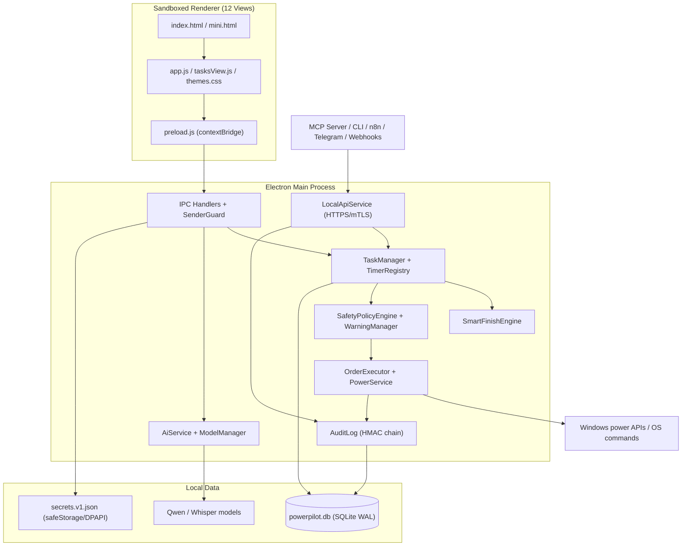

<div align="center">

<a href="https://vellium.dev" target="_blank" rel="noopener noreferrer">
  
</a>

<br /><br />

#  Power Pilot — Local-First Windows Power Management & Automation

</div>

---

<div align="center">

[](#english-version)
&nbsp;&nbsp;&nbsp;&nbsp;
[](#turkish-version)

</div>

---

<div align="center">

[](https://github.com/emirtdede/power-pilot/actions/workflows/ci.yml)


</div>

---

<a id="english-version"></a>
# English Version

<div align="center">
  
  <h3>Power Pilot — Smart, Local-First Power Management &amp; Task Automation for Windows</h3>
  <p><em>Scheduled Power Transitions, Smart Finish Condition Engine, On-Device AI, Built-in MCP Server, Terminal CLI, 28 Themes, and a Hardened Local API</em></p>
  <p><strong>Developed &amp; Published by <a href="https://vellium.dev">Vellium</a></strong></p>
</div>

<br>

##  Project Overview

**Power Pilot (`v1.0.0`)** is a local-first Windows desktop application for scheduling, monitoring, and automating power transitions. Built with **Electron 43**, **Node.js 24**, and **vanilla JavaScript**, it combines a hardened main process, a sandboxed 60 FPS renderer, and a local **WAL-mode SQLite** database. Core scheduling works without an account, a cloud service, or an internet connection.

It goes beyond a simple countdown. **Smart Finish** waits for real work to finish — a process to close, CPU usage to drop, network or disk activity to settle, battery thresholds, user idle time, or a file/folder to stop changing. The **Safety Policy Engine** blocks risky actions while protected applications are running, and the optional **on-device AI assistant** turns natural-language or voice commands into automation tasks using locally stored Qwen and Whisper models.

For developers, AI coding agents, and enterprise teams, Power Pilot ships with a **built-in Model Context Protocol (MCP) server** (`powerpilot-mcp` / `powerpilot mcp`), a **terminal CLI** (`powerpilot`), a dedicated **in-app Documentation Center**, **multi-subpage Settings with one-click preset profiles**, and an optional **local REST API** with API-key roles, TLS/mTLS, IP allowlists, Ed25519-signed orders, webhooks, Wake-on-LAN, an n8n/Telegram workflow, and a headless Windows service agent. Every remote path is designed to fail closed.

> **Documentation:** architecture, release process, runbooks, and API references are indexed in [`docs/README.md`](docs/README.md).

---

##  Key Features

###  Power Actions & Scheduling
- **Shutdown**, **Restart**, **Sleep**, **Hibernate**, **Lock**, and **Sign out** actions.
- Quick presets (15 min, 30 min, 1 hour, 2 hours) and custom countdowns integrated directly inside the scheduling card without detached floating footer bars.
- Safety-capped scheduling up to **24 days** (2,073,600 seconds).
- Persistent tasks with a pre-action warning countdown, snooze, cancel, and optional **4 / 6 / 8-digit PIN protection**.
- Automatic UI-language detection from the Windows display locale on first launch.

###  Smart Finish Condition Engine
- Wait for a selected **process** to close (`handbrake.exe`, `blender.exe`, `steam.exe`, etc.).
- Wait for **CPU usage**, **network throughput**, or **disk activity** to remain below a configured threshold.
- Wait for keyboard/mouse **idle time** or **battery percentage** thresholds.
- Wait for a **file or folder** to stop growing/changing.
- Configurable **AND / OR condition operator**, **stability duration** (default 15–60 seconds), **recurring schedules** (daily, weekdays, weekends, custom days), and **action chaining**.

###  Safety, Fallbacks & Task Lifecycle
- **Protected-app rules** for games, IDEs, render tools, fullscreen presentations, and active disk/network I/O.
- **Configurable Power Action Fallbacks**: automatically fall back (e.g., *Hibernate → Sleep*, *Sleep → Lock*, or *Retry Once after 30s*) if the OS or hardware rejects the primary transition.
- Conflict resolution: one priority action at a time; conflicting tasks become `Blocked`.
- **Fail-closed remote shutdown protection** while the user is actively using the PC.
- Full task states: `Draft`, `Scheduled`, `Monitoring`, `Warning`, `Snoozed`, `Executing`, `Completed`, `Blocked`, `Failed`, `Expired`.

###  On-Device AI Assistant 2.0 (Tasks, Templates, Connections & Docs RAG)
- Optional **Qwen** local LLM and **Whisper** speech-to-text for natural-language and voice commands.
- **7 Specialized Local Agents**: create timers/tasks, build custom automation templates (`templateAgent`), propose human-in-the-loop integration settings (`connectionAgent`), diagnose system blockers, estimate energy savings, and answer product/troubleshooting questions via offline **Documentation RAG** (`DocsKnowledgeBase` + `docsQaAgent`) with one-click deep links.
- Model files stay on the device; downloads are pinned to immutable URLs and verified by **SHA-256**.

###  22 Categorized Automation Templates & Custom Builder
- **22 Built-in Templates Across 7 Categories**: *Download*, *Render & Disk*, *Gaming*, *Productivity*, *Scheduled*, *Power & Battery*, and *Security* (plus *Custom*).
- Supports **Smart Finish conditions**, **time-of-day schedules**, and **countdown duration triggers**.
- Full CRUD: create custom templates from scratch, edit/override built-in templates (with *Modified* badge), duplicate, hide/delete, reset individual templates, or manage/restore all defaults in one click.

###  Rich Energy, CO₂ & Automation Analytics
- Period filtering (**7 Days**, **30 Days**, **All Time**) with verified shutdown-to-next-boot off-duration matching.
- **4 Primary KPI Cards** (*Prevented Uptime*, *Energy Saved kWh + Monthly Forecast*, *Cost Saved + Yearly Forecast*, *Estimated CO₂ Reduction at 0.42 kg/kWh + Success Rate*) and **5 Secondary Operational Metrics** (*Completed*, *Blocked*, *Cancelled/Snoozed*, *Active Streak Days*, *Longest Off Session*).
- Interactive **SVG daily trend bar chart**, **action & trigger-source distributions**, **24-hour automation intensity heatmap**, **recent measured sessions table**, and **CSV / JSON export**.

###  Built-in MCP Server, Terminal CLI & 10-Section Documentation Center
- **Built-in MCP Server (`src/mcp/server.js`)**: JSON-RPC 2.0 over stdio for **Claude Desktop**, **Cursor**, **Antigravity**, **Windsurf**, and **Cline** with 8 tools (`powerpilot_status`, `powerpilot_schedule_timer`, `powerpilot_cancel_timer`, `powerpilot_list_tasks`, `powerpilot_power_action`, `powerpilot_audit_verify`, `powerpilot_inventory`, `powerpilot_pending_orders`).
- **Terminal & PowerShell CLI (`powerpilot`)**: schedule timers (`--minutes` or `--durationMs`), list/cancel tasks, verify audit chains, trigger immediate power actions, or output raw `--json` for scripts.
- **10-Section In-App Documentation Center with Instant Search**: split-layout guide covering Quick Start, Power & Safety Shields, Smart Finish, Templates, AI Assistant, CLI & Terminal, MCP Server JSON configs, REST API & Webhooks, WoL/UPS/Enterprise, and Shortcuts & Troubleshooting.

###  8-Subpage Settings, Curated Presets & Diagnostics Center
- **8 Dedicated Settings Sub-Pages**: *General & Profiles*, *Appearance & Language*, *Notifications & Sound*, *Automation & Fallbacks*, *Energy & AI*, *Keyboard Shortcuts* (interactive key recorder), *Reset & Privacy*, and *Diagnostics & Reports*.
- **Diagnostics, Crash Reports & Support Bundle (ZIP)**: inspect redacted crash/error history, renderer errors, system summary, and main-process logs, or export a pure-Node Deflate support ZIP (`powerpilot-support-*.zip`).
- **One-Click Preset Profiles**: *Standard User (Recommended)*, *Night Download & Render*, *Enterprise & Kiosk Security*, and *Maximum Energy Saver*.
- **Instant Auto-Save + Critical Action Confirmation**: regular preferences save immediately on change; high-impact changes (*Full AI Autonomy*, *Restore Defaults*, *Delete All Data*) require explicit confirmation dialogs.

###  28 Theme Palettes, 4 System-Wide App Icons & 73-Language Catalog
- **2 Modes × 14 Color Themes (28 Palettes)**: `Obsidian`, `Slate`, `Navy`, `Blue`, `Cyan`, `Indigo`, `Purple`, `Pink`, `Red`, `Orange`, `Yellow`, `Emerald`, `Grass`, and `Lime` across Light and Dark modes.
- **4 Selectable System-Wide App & Desktop Icons**: `Monochrome Dark` (default), `Monochrome Light`, `High-Contrast Monochrome`, and `Classic Cyan` — synchronized live across the main window, mini widget, system tray, taskbar, in-app SVG brand marks, and Windows Desktop / Start Menu shortcuts (`.lnk`).
- **73-Language Catalog**: 17 fully translated locales (Turkish, English, German, Swedish, Norwegian, Danish, French, Polish, Italian, Dutch, Czech, Spanish, Portuguese, Japanese, Chinese, Korean, Arabic — 1,156 keys each, parity enforced in CI) + 56 selectable languages with automatic English fallback and full **RTL** mirroring (`ar`, `he`, `fa`, `ur`).

###  7-Subpage Integrations & Local REST API
- Dedicated split-navigation pages for **Local REST API (OpenAPI 3.0)**, **Outbound Webhooks**, **MCP Server (AI)**, **CLI & Scripts**, **Wake-on-LAN** (with saved devices list), **UPS / NUT Monitor**, and **Enterprise Console**.
- API-key roles (`viewer`, `operator`, `admin`), TLS/mTLS, IP/CIDR allowlisting, Ed25519-signed orders, **n8n + Telegram** workflow in [`integrations/n8n/`](integrations/n8n/), and headless Windows service agent.

---

##  Tech Stack

<div align="center">


</div>

### Runtime & UI
- **Electron 43.8.1** — Windows desktop runtime, tray, frameless window controls, and native integration
- **Node.js 24.18.1+** — main-process services, IPC, CLI, and MCP stdio server
- **HTML5 + CSS3 + vanilla JavaScript** — zero frontend framework overhead, locked 60 FPS GPU-friendly transitions
- **Tailwind CSS 3.4.19** — build-time utility CSS, no runtime CDN
- **Material Symbols + Public Sans** — locally bundled icon and text fonts

### Data & Security
- **better-sqlite3 13** — WAL-mode SQLite with atomic migrations and `secure_delete`
- **@node-rs/argon2 2.2** — Argon2id PIN hashing (4 / 6 / 8 digits) with attempt lockout
- **Electron `safeStorage` / Windows DPAPI** — encrypted secrets at rest
- **Ed25519 + HMAC-SHA256** — signed orders and a tamper-evident audit chain
- **TLS/mTLS** — optional HTTPS local API with client certificates
- **Electron fuses + ASAR integrity** — hardened production packaging

### Automation, AI & Integrations
- **TaskManager + TimerRegistry** — persistent scheduling and execution claims
- **SmartFinishEngine + SafetyPolicyEngine** — condition evaluation, fallbacks, and fail-closed policies
- **node-llama-cpp 3.20 + @fugood/whisper.node** — local Qwen/Whisper AI stack
- **Built-in MCP Server + Local REST API (OpenAPI 3.0)** — AI agents, n8n, CLI, webhook, and enterprise integrations

### Build, Test & Release
- **electron-builder 26.15** — custom Windows 11 NSIS installer/uninstaller, Portable build, and APPX packaging
- **Vitest + Playwright 1.64** - 166 unit test suites and 26 Electron E2E test specs
- **GitHub Actions** — CI (`main` and `development` branches), dependency audit, SBOM, signing, and release gates

---

##  Project Structure

```tree
Power_Pilot/
├── .github/                         # CI, Dependabot, issue/PR templates, security policy
├── assets/
│   └── vellium-banner.svg           # Pure black-and-white animated Vellium header banner
├── build/
│   ├── appx/                        # Microsoft Store / APPX tile and splash assets
│   ├── installerSidebar.bmp         # Custom 24-bit NSIS welcome/finish sidebar (version-free)
│   ├── uninstallerSidebar.bmp       # Custom 24-bit NSIS uninstaller sidebar (version-free)
│   ├── installerHeader.bmp          # Custom 24-bit NSIS inner page header (version-free)
│   └── installer.nsh                # Custom NSIS install/uninstall hooks & Task Scheduler cleanup
├── docs/                            # Architecture, release, runbooks, API schema
│   ├── architecture/                # Automation, Smart Finish, safety, local API, accessibility
│   ├── integrations/                # n8n and PowerShell/CLI guides
│   ├── openapi/                     # OpenAPI 3.0 schema for the local REST API
│   ├── release/                     # Signing, ASAR integrity, SBOM documentation
│   ├── reports/                     # Soak test and dependency license reports
│   ├── runbooks/                    # Incident response and operations
│   └── store/                       # Microsoft Store listing metadata and privacy policy
├── integrations/n8n/workflows/      # Ready-to-import n8n workflow (Telegram timer)
├── public/                          # Canonical Power Pilot & Vellium brand SVGs
├── scripts/                         # Release, packaging, NSIS asset generator, security, SBOM tools
├── src/
│   ├── agent/                       # Headless Windows service agent
│   ├── assets/                      # App and publisher logos
│   ├── cli/                         # Command-line client (powerpilot & commands catalog)
│   ├── console/                     # Enterprise console server and store
│   ├── mcp/
│   │   └── server.js                # Built-in JSON-RPC 2.0 stdio MCP server (8 tools, 2 resources)
│   ├── main/
│   │   ├── ai/                      # Input normalization and AI helpers
│   │   ├── config/                  # Feature flags and external-link policy
│   │   ├── ipc/                     # IPC validation and sender guard
│   │   ├── locales/                 # 17 server-side locale dictionaries
│   │   ├── order/                   # Signed order schema and nonce store
│   │   ├── security/                # App protocol, CSP, PIN, secrets, TLS, SSRF
│   │   ├── services/                # Task, power, AI, API, audit and history services
│   │   ├── storage/                 # SQLite storage and migrations
│   │   └── util/                    # Timers, crash guard, portable mode, and shared helpers
│   ├── renderer/                    # 12-view UI, 28-palette themes.css, mini widget, and 73-locale i18n
│   ├── vendor/fonts/                # Locally bundled Material Symbols and Public Sans
│   ├── index.html                   # Main frameless window markup (12 views)
│   └── mini.html                    # Compact always-on-top mini widget
├── tests/                           # Vitest unit tests (150 files) and Playwright Electron E2E tests
├── main.js                          # Electron main process, tray, windows, and IPC
├── preload.js                       # Context-isolated renderer bridge
├── electron-builder.config.cjs      # Signing-aware electron-builder configuration
└── package.json                     # Scripts, bin (powerpilot / powerpilot-mcp), and v1.0.0 metadata
```

---

##  Architecture & Security Boundaries



**Security model.** The renderer never receives Node.js access. It runs with `sandbox: true` and `contextIsolation: true` behind the custom `app://powerpilot` protocol, a strict Content-Security-Policy, and an IPC sender allowlist. Every IPC payload is validated in the main process. Remote access is opt-in, bound to loopback by default, and protected by hashed API keys, role checks, rate limits, IP/CIDR allowlists, TLS/mTLS, and fail-closed remote-shutdown rules. Signed orders use Ed25519 with nonce replay protection, while the audit trail is chained with HMAC-SHA256 and daily checkpoints. Secrets are stored with Electron `safeStorage`/Windows DPAPI; PINs are hashed with Argon2id and protected by attempt lockout.

---

##  Storage & Security Schema

| Path / Boundary | Protection | Contents |
| :--- | :--- | :--- |
| `%APPDATA%\powerpilot\powerpilot.db` | SQLite WAL, `secure_delete`, `quick_check` | Tasks, history, settings, and audit records |
| `%APPDATA%\powerpilot\secrets.v1.json` | Electron `safeStorage` / Windows DPAPI | API keys, TLS material, webhook secrets |
| `%APPDATA%\powerpilot\models\` | SHA-256 pinned downloads | Local Qwen LLM and Whisper STT models |
| `%APPDATA%\powerpilot\backups\` | App-managed backups | Database and log backups |
| `%APPDATA%\powerpilot\logs\` | Redacted diagnostics | Runtime and audit-support logs |
| Renderer ↔ main IPC | `contextIsolation`, `sandbox`, sender allowlist | Validated commands and events |

---

##  CLI & Built-in MCP Server Usage

### Terminal & PowerShell CLI (`powerpilot`)

```powershell
# Set your Local API key (generated in Integrations -> Create API Key)
$env:POWERPILOT_API_KEY = "<your-api-key>"

# Query service status and active countdown
node src/cli/powerpilot.js status --json

# Schedule a 45-minute shutdown timer
node src/cli/powerpilot.js timer --action shutdown --minutes 45 --name "Night Render"

# List scheduled and active tasks
node src/cli/powerpilot.js tasks --limit 20 --json

# Cancel a task by ID
node src/cli/powerpilot.js cancel --id task_1

# Verify HMAC-SHA256 audit log chain integrity
node src/cli/powerpilot.js audit-verify
```

### Model Context Protocol (MCP) Server (`powerpilot-mcp`)

Add Power Pilot to **Claude Desktop**, **Cursor**, **Antigravity**, **Windsurf**, or **Cline**:

```json
{
  "mcpServers": {
    "powerpilot": {
      "command": "node",
      "args": ["src/mcp/server.js"],
      "env": {
        "POWERPILOT_API_KEY": "<your-api-key>",
        "POWERPILOT_API_HOST": "127.0.0.1",
        "POWERPILOT_API_PORT": "18456"
      }
    }
  }
}
```

---

##  Installation & Usage

### Installing as an end user (from the setup file)

1. Download `Power Pilot Setup 1.0.0.exe` (or `Power Pilot Portable 1.0.0.exe`).
2. Run it. **No administrator (UAC) prompt is requested** — it installs per-user (`asInvoker`, `perMachine: false`) into `%LOCALAPPDATA%\Programs\Power Pilot`.
3. You can pick a different install directory in the custom Vellium setup wizard.
4. After install, **Power Pilot** appears in the Start menu.

**SmartScreen on unsigned downloads:** Until release signing (Azure Trusted Signing or Microsoft Store) is applied, Windows may show the blue "Windows protected your PC" prompt on first run. Choose **More info → Run anyway**. The Store (MSIX) build is re-signed by Microsoft and never shows it.

**Uninstall:** Windows Settings → Apps → Power Pilot → Uninstall. The custom uninstaller cleans up `\PowerPilot*` Windows Task Scheduler entries and lets you choose whether to keep or permanently remove your local `%APPDATA%\powerpilot` data.

### Prerequisites (building from source)
- **Windows 10 (1809+) or Windows 11** (64-bit)
- **Node.js 24.18.1+** and npm
- **Git**

### Run from Source

```bash
git clone https://github.com/emirtdede/power-pilot.git
cd power-pilot
npm install
npm start
```

### Tests & Release Gates

```bash
npm test                 # Vitest unit tests (166 suites)
npm run test:security    # Static security & CSP checks
npm run test:e2e         # Playwright Electron E2E suite
npm run coverage         # Coverage report (release gate)
npm run locales:check    # 17-language key parity & unused key check
npm run models:verify    # Model manifests and SHA-256 pins
npm run release:check    # Release consistency gate (v1.0.0)
```

### Build Installers

```bash
# NSIS setup (dist/Power Pilot Setup 1.0.0.exe)
npm run dist:nsis

# Portable single-file build (dist/Power Pilot Portable 1.0.0.exe)
npm run dist:portable

# APPX package (requires Windows SDK and APPX_PUBLISHER)
npm run dist:appx

# Unpacked application and packaging verification
npm run pack
npm run verify:pack
```

---

##  Distribution Packages

Build artifacts are produced under `dist/`:

- **NSIS installer** — `Power Pilot Setup 1.0.0.exe`
- **Portable executable** — `Power Pilot Portable 1.0.0.exe` (stores data in adjacent `PowerPilotData/`)
- **APPX package** — `Power Pilot 1.0.0.appx`
- **Unpacked build** — `dist/win-unpacked/` via `npm run pack`
- **SBOM** — `npm run sbom`
- **Signature verification** — `npm run verify:signature`

Published builds and release notes are available on the [GitHub Releases](https://github.com/emirtdede/power-pilot/releases) page.

---

##  License & Publisher

**Proprietary commercial software.** Copyright © 2026 **Vellium Teknoloji Anonim Şirketi**. All rights reserved.

No rights are granted to copy, modify, publish, distribute, sublicense, or sell the software except under a separate written commercial or pilot agreement with Vellium Teknoloji Anonim Şirketi. See [`LICENSE`](LICENSE) for the full terms.

- **Publisher:** Vellium Teknoloji Anonim Şirketi ([Company Information](https://vellium.dev/en/legal/company-information))
- **Official Website & Product Page:** [vellium.dev](https://vellium.dev) &bull; [vellium.dev/en/products/power-pilot](https://vellium.dev/en/products/power-pilot) &bull; [Microsoft Store](https://apps.microsoft.com/detail/9NQJTP1BKP5R)
- **Legal Hub:** [Privacy Policy](https://vellium.dev/en/legal/privacy) &bull; [Terms of Service](https://vellium.dev/en/legal/terms) &bull; [Support Policy](https://vellium.dev/en/legal/support) &bull; [Security Disclosure](https://vellium.dev/en/legal/security-disclosure) &bull; [KVKK Notice](https://vellium.dev/en/legal/kvkk-notice)
- **Official Emails:** General [contact@vellium.dev](mailto:contact@vellium.dev) &bull; Support [support@vellium.dev](mailto:support@vellium.dev) &bull; Privacy [privacy@vellium.dev](mailto:privacy@vellium.dev) &bull; Legal [legal@vellium.dev](mailto:legal@vellium.dev) &bull; Security [security@vellium.dev](mailto:security@vellium.dev) &bull; Billing [billing@vellium.dev](mailto:billing@vellium.dev)
- **Official Social & Community Channels:** [GitHub @VelliumHQ](https://github.com/VelliumHQ) &bull; [LinkedIn](https://www.linkedin.com/company/vellium/) &bull; [X @VelliumDev](https://x.com/VelliumDev) &bull; [Product Hunt @vellium](https://www.producthunt.com/@vellium) &bull; [Instagram @velliumdev](https://www.instagram.com/velliumdev/) &bull; [Threads @velliumdev](https://www.threads.com/@velliumdev) &bull; [Reddit u/VelliumDev](https://www.reddit.com/user/VelliumDev/) &bull; [Discord](https://discord.gg/ur9KBZBEdj)

---

<br>

---

<a id="turkish-version"></a>
# Türkçe Versiyon

<div align="center">
  
  <h3>Power Pilot — Windows İçin Akıllı, Yerel Öncelikli Güç Yönetimi ve Görev Otomasyonu</h3>
  <p><em>Zamanlanmış Güç Eylemleri, Smart Finish Koşul Motoru, Cihaz Üzeri Yapay Zekâ, Yerleşik MCP Sunucusu, Terminal CLI, 28 Tema ve Sıkılaştırılmış Yerel API</em></p>
  <p><strong>Geliştirici ve Yayıncı: <a href="https://vellium.dev">Vellium</a></strong></p>
</div>

<br>

##  Proje Genel Bakışı

**Power Pilot (`v1.0.0`)**, güç geçişlerini zamanlamak, izlemek ve otomatikleştirmek için geliştirilmiş, yerel öncelikli bir Windows masaüstü uygulamasıdır. **Electron 43**, **Node.js 24** ve **vanilla JavaScript** ile geliştirilmiştir; sıkılaştırılmış bir ana süreç, sandbox içinde 60 FPS çalışan arayüz ve yerel bir **WAL modlu SQLite** veritabanını bir araya getirir. Temel zamanlama; hesap, bulut servisi veya internet bağlantısı gerektirmez.

Power Pilot basit bir geri sayımdan daha fazlasını yapar. **Smart Finish**, gerçek işin bittiğini algılar: seçilen sürecin kapanması, CPU kullanımının, ağ trafiğinin veya disk etkinliğinin eşiğin altına düşmesi, pil yüzdesi, kullanıcının boşta kalması ya da bir dosya/klasörün değişmeyi bırakması. **Güvenlik Politikası Motoru**, korunan uygulamalar açıkken riskli eylemleri engeller; isteğe bağlı **cihaz üzeri yapay zekâ asistanı** ise doğal dil veya sesli komutları yerel Qwen ve Whisper modelleriyle otomasyon görevlerine dönüştürür.

Geliştiriciler, yapay zekâ kodlama ajanları ve kurumsal ekipler için Power Pilot; **yerleşik Model Context Protocol (MCP) sunucusu** (`powerpilot-mcp` / `powerpilot mcp`), **terminal CLI istemcisi** (`powerpilot`), kenar menüsünde bağımsız **Dokümantasyon Merkezi**, **tek tıkla hazır profiller sunan çoklu alt sayfalı Ayarlar mimarisi** ve isteğe bağlı **yerel REST API** (API anahtarı rolleri, TLS/mTLS, IP izin listeleri, Ed25519 imzalı emirler, webhook'lar, Wake-on-LAN, n8n/Telegram iş akışı ve başsız Windows servis ajanı) ile birlikte gelir.

> **Dokümantasyon:** mimari, sürüm süreci, runbook'lar ve API referansları [`docs/README.md`](docs/README.md) içinde indekslenmiştir.

---

##  Öne Çıkan Özellikler

###  Güç Eylemleri ve Zamanlama
- **Kapatma**, **Yeniden Başlatma**, **Uyku**, **Hazırda Bekletme**, **Kilitleme** ve **Oturumu Kapatma** eylemleri.
- Hızlı ön ayarlar (15 dk, 30 dk, 1 saat, 2 saat) ve bağımsız alt katman olmadan doğrudan kart içine entegre başlatma/iptal kontrolleri.
- **24 güne** (2.073.600 saniye) kadar güvenlik sınırlı zamanlama.
- Eylem öncesi uyarı geri sayımı, erteleme, iptal ve isteğe bağlı **4 / 6 / 8 haneli PIN koruması** ile kalıcı görevler.

###  Smart Finish Koşul Motoru
- Seçilen **sürecin** kapanmasını bekleme (`handbrake.exe`, `blender.exe`, `steam.exe` vb.).
- **CPU kullanımının**, **ağ hızının** veya **disk etkinliğinin** belirlenen eşiğin altında kalmasını bekleme.
- Klavye/fare **boşta kalma süresini** veya **batarya seviyesini** bekleme.
- Bir **dosya veya klasörün** büyümeyi/değişmeyi bırakmasını bekleme.
- Yapılandırılabilir **VE / VEYA koşul bağlacı**, **kararlılık süresi** (varsayılan 15–60 sn), **tekrarlayan program** (her gün, hafta içi, hafta sonu, özel günler) ve **zincirleme güç eylemleri**.

###  Güvenlik, Fallback ve Görev Yaşam Döngüsü
- Oyunlar, IDE'ler, render araçları, tam ekran sunumlar ve yoğun ağ/disk G/Ç işlemleri için **korunan uygulama kuralları**.
- **Güç Eylemi Yedekleme (Fallback) Mekanizması**: birincil güç eylemi işletim sistemi veya donanım tarafından reddedilirse otomatik yedek eylem (*Hazırda Beklet → Uyku*, *Uyku → Ekranı Kilitle* veya *30 sn sonra yeniden dene*).
- Kullanıcı aktifken **fail-closed uzaktan kapatma koruması**.

###  Cihaz Üzeri Yapay Zekâ Asistanı 2.0 (Görev, Şablon, Bağlantı ve Doküman RAG)
- İsteğe bağlı yerel **Qwen** LLM ve **Whisper** konuşmadan metne (STT) motorları; model dosyaları SHA-256 doğrulamalıdır ve bilgisayardan dışarı çıkmaz.
- **7 Uzman Yerel Ajan (`AgentOrchestrator`)**: doğal dille görev kurma, özel şablon oluşturma (`templateAgent`), insan-onaylı entegrasyon yapılandırma önerisi (`connectionAgent`), sistem engelleyici teşhisi, enerji tasarrufu tahmini ve yerleşik bilgi tabanı (`DocsKnowledgeBase` + `docsQaAgent`) üzerinden çevrimdışı dokümantasyon soru-cevap + bölüm derin bağlantıları.

###  22 Kategorili Otomasyon Şablonu ve Özel Şablon Oluşturucu
- **7 Kategoride 22 Hazır Şablon**: *İndirme*, *Render ve Disk*, *Oyun*, *Üretkenlik*, *Zamanlı*, *Güç ve Pil*, *Güvenlik* (ve *Özel*).
- **Geri sayım süresi**, **belirli saat** ve **Smart Finish koşul** tetikleyicileri; sıfırdan özel şablon oluşturma, mevcut şablonları düzenleme (*Düzenlendi* rozeti), çoğaltma, gizleme/silme, tekil sıfırlama ve tüm varsayılanları tek tıkla geri getirme.

###  Zenginleştirilmiş Enerji, CO₂ ve Otomasyon İstatistikleri
- **7 Gün / 30 Gün / Tümü** dönem filtresi ve gerçek kapanış–yeniden açılış süresine dayalı doğrulama.
- **4 Ana KPI Kartı** (*Önlenen Açık Kalma*, *Enerji Tasarrufu kWh + Aylık Projeksiyon*, *Maliyet Tasarrufu + Yıllık Projeksiyon*, *0.42 kg/kWh CO₂ Azaltımı + Başarı Oranı*), **5 İkincil Operasyonel Metrik**, etkileşimli **SVG günlük trend grafiği**, **eylem/kaynak dağılımları**, **24 saatlik yoğunluk haritası**, **ölçülen oturumlar tablosu** ve **CSV / JSON dışa aktarma**.

###  Yerleşik MCP Sunucusu, Terminal CLI ve 10 Bölümlü Dokümantasyon Merkezi
- **Yerleşik MCP Sunucusu (`src/mcp/server.js`)**: **Claude Desktop**, **Cursor**, **Antigravity**, **Windsurf** ve **Cline** ajanları için 8 araçlık (`powerpilot_status`, `powerpilot_schedule_timer`, `powerpilot_cancel_timer`, `powerpilot_list_tasks`, `powerpilot_power_action`, `powerpilot_audit_verify`, `powerpilot_inventory`, `powerpilot_pending_orders`) stdio JSON-RPC 2.0 sunucusu.
- **Terminal ve PowerShell CLI (`powerpilot`)**: `--minutes` veya `--durationMs` ile görev kurma, görev listeleme/iptal, denetim zinciri doğrulama ve `--json` çıktısı.
- **Anlık Aramalı 10 Bölümlü Dokümantasyon Merkezi**: Hızlı Başlangıç, Güç ve Güvenlik, Smart Finish, Şablonlar, Yapay Zekâ Asistanı, CLI ve Terminal, MCP Sunucusu, REST API ve Webhooks, WoL/UPS/Kurumsal, Kısayollar ve Yardım alt sayfaları.

###  8 Alt Sayfalı Ayarlar, Hazır Profiller ve Tanılama Merkezi
- **8 Ayrı Ayar Alt Sayfası**: *Genel ve Profiller*, *Görünüm ve Dil*, *Bildirimler ve Ses*, *Otomasyon ve Fallback*, *Enerji ve Yapay Zekâ*, *Klavye Kısayolları* (canlı tuş kaydedici), *Sıfırlama ve Gizlilik*, *Tanılama ve Raporlar*.
- **Tanılama, Çökme Raporları ve Destek Paketi (ZIP)**: maskelenmiş çökme/hata, arayüz, sistem ve ana süreç günlüklerini görüntüleme ve tek tıkla `powerpilot-support-*.zip` destek paketi üretme.
- **Tek Tıkla Hazır Profiller**: *Standart Kullanıcı (Önerilen)*, *Gece İndirme ve Render*, *Kurumsal ve Kiosk Güvenliği*, *Maksimum Enerji Tasarrufu*.

###  28 Tema Paleti, 4 Sistem Geneli Uygulama İkonu ve 73 Dil Kataloğu
- **2 Mod × 14 Renk Teması (28 Palet)**: Açık ve Koyu modlarda `Siyah (Obsidian)`, `Gri`, `Lacivert`, `Mavi`, `Cyan`, `İndigo`, `Mor`, `Pembe`, `Kırmızı`, `Turuncu`, `Sarı`, `Zümrüt Yeşili`, `Çimen Yeşili` ve `Açık Yeşil`.
- **4 Seçilebilir Sistem Geneli Uygulama ve Masaüstü İkonu**: `Koyu Monokrom` (varsayılan), `Açık Monokrom`, `Saf Siyah-Beyaz` ve `Klasik Cyan` — ana pencere, mini widget, sistem tepsisi, görev çubuğu, uygulama içi SVG logolar ve Windows Masaüstü/Başlat kısayollarında (`.lnk`) eşzamanlı güncellenir.
- **73 Dil Desteği**: 17 tam çevrili dil (her biri 1.156 anahtar; parite CI'da zorunlu) + 56 seçilebilir dil için otomatik İngilizce yedekleme (fallback) ve 4 RTL dil (`ar`, `he`, `fa`, `ur`) için sağdan-sola arayüz desteği.

###  7 Alt Sayfalı Entegrasyonlar ve Yerel REST API
- **Yerel REST API (OpenAPI 3.0)**, **Webhooks**, **MCP Sunucusu (AI)**, **CLI ve Betikler**, **Wake-on-LAN** (kayıtlı cihazlar listesi), **UPS / NUT İzleme** ve **Kurumsal Konsol** için bağımsız alt sayfalar.

---

##  Kurulum ve Kullanım

### Son kullanıcı için kurulum (kurulum dosyasından)

1. `Power Pilot Setup 1.0.0.exe` (veya taşınabilir `Power Pilot Portable 1.0.0.exe`) dosyasını indirin.
2. Çalıştırın. **Yönetici (UAC) izni istenmez** — kurulum kullanıcı hesabına (`%LOCALAPPDATA%\Programs\Power Pilot`) yapılır.
3. Özel Vellium kurulum sihirbazında dilerseniz farklı bir kurulum dizini seçebilirsiniz.
4. Kurulumdan sonra Başlat menüsünde **Power Pilot** görünür.

**Kaldırma:** Windows Ayarlar → Uygulamalar → Power Pilot → Kaldır. Özel kaldırma yardımcısı `\PowerPilot*` Windows Görev Zamanlayıcı kayıtlarını otomatik temizler ve yerel kullanıcı verilerinizi (`%APPDATA%\powerpilot`) koruma veya kalıcı olarak silme seçeneği sunar.

### Kaynaktan Çalıştırma ve Derleme

```bash
git clone https://github.com/emirtdede/power-pilot.git
cd power-pilot
npm install
npm start

# Test ve Sürüm Kapıları
npm test
npm run test:security
npm run test:e2e
npm run locales:check
npm run release:check

# Kurulum ve Taşınabilir Paket Derleme (v1.0.0)
npm run dist:nsis
npm run dist:portable
```

---

##  Lisans ve Yayıncı

**Tescilli ticari yazılım.** Copyright © 2026 **Vellium Teknoloji Anonim Şirketi**. Tüm hakları saklıdır.

Tam koşullar için [`LICENSE`](LICENSE) dosyasına bakın.

- **Yayıncı:** Vellium Teknoloji Anonim Şirketi ([Şirket Bilgileri](https://vellium.dev/tr/yasal/sirket-bilgileri))
- **Resmi Web Sitesi ve Ürün Sayfası:** [vellium.dev](https://vellium.dev) &bull; [vellium.dev/en/products/power-pilot](https://vellium.dev/en/products/power-pilot) &bull; [Microsoft Store](https://apps.microsoft.com/detail/9NQJTP1BKP5R)
- **Yasal Merkez:** [Gizlilik Politikası](https://vellium.dev/tr/yasal/gizlilik-politikasi) &bull; [Hizmet Koşulları](https://vellium.dev/tr/yasal/hizmet-kosullari) &bull; [Destek Politikası](https://vellium.dev/tr/yasal/destek-politikasi) &bull; [Güvenlik Açığı Bildirimi](https://vellium.dev/tr/yasal/guvenlik-acigi-bildirimi) &bull; [KVKK Aydınlatma Metni](https://vellium.dev/tr/yasal/kvkk-aydinlatma-metni)
- **Resmi E-Posta Kanalları:** Genel [contact@vellium.dev](mailto:contact@vellium.dev) &bull; Destek [support@vellium.dev](mailto:support@vellium.dev) &bull; Gizlilik [privacy@vellium.dev](mailto:privacy@vellium.dev) &bull; Hukuk [legal@vellium.dev](mailto:legal@vellium.dev) &bull; Güvenlik [security@vellium.dev](mailto:security@vellium.dev) &bull; Faturalandırma [billing@vellium.dev](mailto:billing@vellium.dev)
- **Resmi Sosyal Medya ve Topluluk Hesapları:** [GitHub @VelliumHQ](https://github.com/VelliumHQ) &bull; [LinkedIn](https://www.linkedin.com/company/vellium/) &bull; [X @VelliumDev](https://x.com/VelliumDev) &bull; [Product Hunt @vellium](https://www.producthunt.com/@vellium) &bull; [Instagram @velliumdev](https://www.instagram.com/velliumdev/) &bull; [Threads @velliumdev](https://www.threads.com/@velliumdev) &bull; [Reddit u/VelliumDev](https://www.reddit.com/user/VelliumDev/) &bull; [Discord](https://discord.gg/ur9KBZBEdj)
